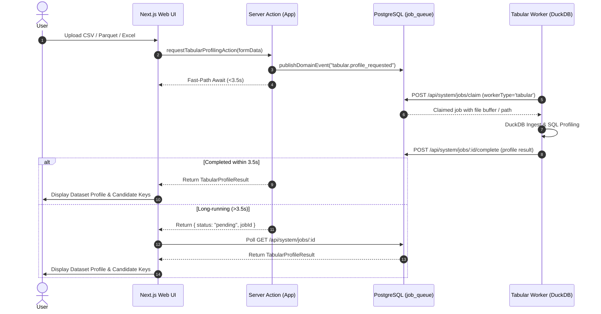

# Design Spec: Multi-Source Tabular Ingestion & DuckDB Profiling Worker

**Date:** 2026-11-05  
**Status:** Draft for Review  
**Target Phase:** Phase 3 — Multi-Source Tabular Ingestion & Privacy (`helix-foundry`)  
**Scope:** Foundational Tabular Worker (`services/tabular`), DuckDB analytical profiling engine, file ingestion (CSV, Parquet, Excel), and workbench integration.

---

## 1. Intent & Context

The Knowledge Graph Workbench currently ingests unstructured text documents via `services/internal-extractor` and validates semantic models via `services/reasoner`. Enterprise data, however, predominantly lives in tabular formats: relational database dumps, Parquet analytic files, CSV exports, and multi-sheet Excel workbooks.

Before an LLM can induce classes or generate knowledge graph triples from tables without hallucinations, the raw tabular data must be deterministically profiled: column data types, value distributions, uniqueness constraints, null ratios, and candidate primary/foreign keys must be extracted with zero guesswork.

This specification designs the **Tabular Worker sidecar (`services/tabular`)** powered by **DuckDB**, integrated into the existing transactional outbox and job queue architecture, paired with an interactive profiling inspector in the Next.js frontend.

---

## 2. Goals, Non-Goals & Anti-Goals

### Goals
1. **Containerized DuckDB Worker**: Create `services/tabular` container configured via `uv`, with background heartbeat pinging `system_services` and queue polling loop claiming `target_worker = 'tabular'`.
2. **Multi-Format Analytical Profiling**: Support CSV, Parquet, and Excel (`.xlsx`) datasets:
   - Compute row count, column count, memory footprint.
   - Column-level metrics: DuckDB native type, canonical KG Workbench type (`string`, `number`, `boolean`, `date`), null count, distinct count, min/max values, and sample values.
   - Deterministic candidate key detection (single and composite uniqueness checks).
   - Top-N data preview rows for visual verification.
3. **Queue Protocol & Fast-Path UX**: Publish `tabular.profile_requested` domain events, supporting fast-path completion (<3.5s) with background TanStack Query polling fallback.
4. **Interactive Workbench UI**: A dedicated tabular dataset preview component allowing users to drag-and-drop or upload tabular files, inspect profiling metrics, and explore candidate keys.

### Non-Goals (Future Milestones)
- Automated LLM-driven schema induction into the active ontology (Milestone 2 of Phase 3).
- Local PII masking / token replacement pipeline (Milestone 3 of Phase 3).
- Direct read-only database connections (PostgreSQL/MySQL connectors) (Milestone 4 of Phase 3).

### Anti-Goals
- **No Node.js Memory Exhaustion**: Never buffer multi-megabyte CSV/Parquet files in Node.js heap memory or perform analytical aggregation in JavaScript. DuckDB streams and memory-maps files natively.
- **No Unsafe Execution**: Disallow arbitrary user-supplied DuckDB SQL queries without strict read-only execution parameters.

---

## 3. Approaches Considered & Selected

- **Approach 1: Python DuckDB Sidecar Container (Selected)**:
  - *Why*: DuckDB in Python has zero external dependencies, compiles with native C++ speed, handles gigabyte-scale Parquet and CSV files with low RAM overhead, and seamlessly integrates with our existing Python worker architecture (`internal-extractor`, `reasoner`).
  - *Trade-off*: Requires another container service in `deploy/compose.yaml` (profile: `tabular`), matching our modular sidecar pattern.
- **Approach 2: In-Process WebAssembly DuckDB in Next.js / Browser**:
  - *Why not*: Browser WASM DuckDB cannot handle large files without client memory crashes; server-side Node.js DuckDB native addon causes cross-platform compilation friction on Windows/Linux Docker.
- **Approach 3: Pure PostgreSQL Staging Tables**:
  - *Why not*: Loading large ad-hoc CSV/Parquet files directly into PostgreSQL pollutes transactional tables with temporary analytical data and lacks instant Parquet/Excel parsing capabilities.

---

## 4. Architecture & System Flow



---

## 5. Technical Specification

### 5.1 Worker Service: `services/tabular`
- **File Structure**:
  ```
  services/tabular/
  ├── Dockerfile
  ├── pyproject.toml
  ├── README.md
  ├── src/
  │   └── tabular/
  │       ├── __init__.py
  │       ├── config.py
  │       ├── daemon.py
  │       ├── profiler.py
  │       └── main.py
  └── tests/
      └── test_profiler.py
  ```
- **Dependencies**: `duckdb>=1.1.0`, `pyarrow>=17.0.0`, `openpyxl>=3.1.5`, `fastapi>=0.115.0`, `uvicorn>=0.30.0`, `httpx>=0.27.0`, `pydantic>=2.8.0`.

### 5.2 Profiling Engine (`profiler.py`)
Using DuckDB's native readers:
- `read_csv(?, auto_detect=true, sample_size=10000)`
- `read_parquet(?)`
- Excel reader via openpyxl / pandas conversion to Arrow stream.

**Generated Metrics**:
1. `rowCount`: total table rows (`SELECT count(*) FROM table`).
2. `columnCount`: total attributes.
3. `columns`:
   - `name`: string
   - `duckdbType`: e.g. `VARCHAR`, `BIGINT`, `DOUBLE`, `TIMESTAMP`, `BOOLEAN`
   - `inferredKgType`: mapped to `"string" | "number" | "boolean" | "date"`
   - `nullCount` & `nullPercentage`
   - `distinctCount` (`approx_count_distinct` for large datasets, exact for <100k)
   - `isUniqueCandidate`: `distinctCount == rowCount && nullCount == 0`
   - `minValue`, `maxValue`
   - `sampleValues`: Top 5 distinct non-null values
4. `candidateKeys`: List of single or composite candidate keys.
5. `previewRows`: Top 20 rows formatted as JSON records.

### 5.3 Data Contract

```typescript
export interface TabularColumnProfile {
  name: string
  duckdbType: string
  inferredKgType: "string" | "number" | "boolean" | "date"
  nullCount: number
  nullPercentage: number
  distinctCount: number
  isUniqueCandidate: boolean
  minValue?: string | number | null
  maxValue?: string | number | null
  sampleValues: Array<string | number | boolean>
}

export interface TabularProfileResult {
  fileName: string
  fileType: "csv" | "parquet" | "excel"
  rowCount: number
  columnCount: number
  estimatedSizeBytes: number
  columns: TabularColumnProfile[]
  candidateKeys: string[][]
  previewRows: Record<string, unknown>[]
  processedBy: string
}
```

### 5.4 Docker & Deployment Integration
- Update `deploy/compose.yaml` adding `tabular` service under profile `tabular` and `full`.
- Port: `8030:8000`.
- Shared Docker volume or HTTP streaming for file transfer.

### 5.5 UI Component
- **Location**: `src/features/tabular/components/tabular-profiler-modal.tsx` (reusable across documents and ontology workspaces).
- **Tabs**:
  - **Schema & Types**: Columns table showing inferred type, null %, distinct values, and primary key badges.
  - **Data Preview**: Interactive paginated table of top sample rows.
  - **Candidate Keys & Links**: Identified uniqueness candidate columns and foreign key link potentials.

---

## 6. Verification Plan

1. **Unit Tests (`services/tabular/tests/test_profiler.py`)**:
   - Verify DuckDB profiling on synthetic CSVs with nulls, timestamps, numbers, and strings.
   - Verify Parquet parsing and candidate key detection.
   - Verify Excel `.xlsx` multi-sheet extraction.
2. **Queue Integration Test (`tests/tabular-worker-smoke.test.ts`)**:
   - Enqueue a `tabular.profile_requested` event.
   - Await resolution via `fastPathAwaitJob` against live `kg-workbench-tabular` container.
   - Validate returned column metadata and candidate keys.
3. **Frontend Tests**:
   - Component DOM test for `tabular-profiler-modal`.
   - `pnpm lint` and `pnpm typecheck` code quality gates.

