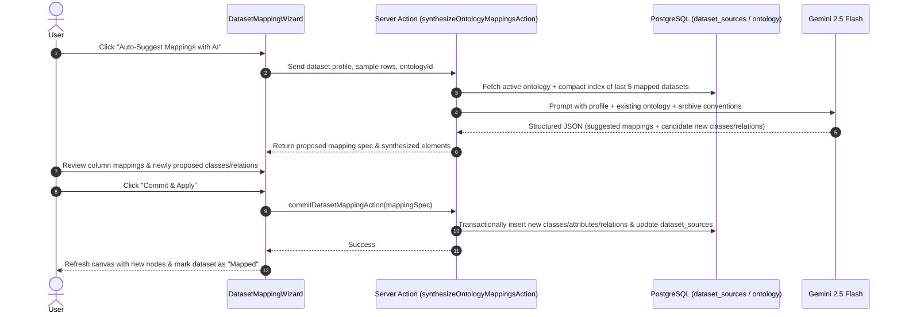
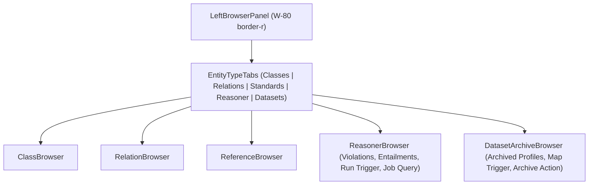

# Design Spec: Tabular Entity-Relation Mapping Wizard, Persistent Dataset Archive & Sidebar Navigation

**Date:** 2026-11-05  
**Status:** Approved by Builder Review & User  
**Target Phase:** Phase 3 — Multi-Source Tabular Ingestion & Privacy (`helix-foundry`), Milestone 2  
**Scope:** AI-driven entity/relationship mapping from profiled tabular datasets, persistent dataset archive catalog, and left-hand workbench sidebar integration (Reasoner + Datasets).

---

## 1. Intent & Context

In Milestone 1 of Phase 3, we built the **DuckDB Tabular Profiler Worker (`services/tabular`)**, enabling real-time analytical profiling (row counts, canonical KG types, null ratios, distinct counts, candidate primary keys, and sample rows) across CSV, Parquet, and Excel files.

However, profiling data is only half the journey. Users need to:

1. **Map tabular data into the knowledge graph**: Connect dataset columns to ontology classes and attributes, or define foreign-key-style relations between classes.
2. **Handle missing ontology concepts gracefully**: When raw datasets represent concepts not yet modeled in the ontology, an AI assistant (leveraging the user's configured Gemini API key) should analyze the dataset schema and sample rows to synthesize candidate classes, attributes, relations, or modules.
3. **Maintain a persistent Dataset Archive**: An archive catalog storing previously ingested datasets, their profiles, and their mapping specifications. This archive serves as historical memory so future dataset additions maintain consistency with existing schema conventions.
4. **Surface Reasoner and Dataset status in the primary workbench**: Provide direct visibility on the left-hand sidebar for both OWL-RL reasoning validation (status, violations, entailments, one-click run) and the Dataset Archive (catalogs, mapping status, re-mapping).

---

## 2. Goals, Non-Goals & Anti-Goals

### Goals

1. **Persistent Dataset Archive (`dataset_sources`)**:
   - Store profiled datasets in PostgreSQL with columns for `id`, `ontology_id`, `group_key`, `source_name`, `file_format`, `row_count`, `column_count`, `profile_summary`, `sample_rows`, `mapping_spec`, `created_at`, `updated_at`.
   - Store lightweight schema profiles and the top 20 sample rows directly in PostgreSQL (works out-of-the-box with `STORAGE_PROVIDER=none`, requires zero external disk/S3 storage).
   - Support archiving from the existing Profiler Modal and listing/filtering in the workbench.
2. **AI Schema Synthesis & Alignment (`ai-mapping-generator`)**:
   - Use the user's existing encrypted Gemini API key (`getEffectiveApiKey("gemini")`).
   - Given a dataset profile + sample rows + existing ontology classes/relations + historical archive schemas:
     - Detect column-to-ontology matches (existing class/attributes).
     - Detect foreign key relationships to other classes.
     - Synthesize new candidate classes, attributes, relations, and modules when concepts are missing.
     - Return validated, strongly typed structured JSON.
   - Inject historical archive schemas as a compact dictionary (last 5 mapped datasets: source name, column names, mapped target classes/attributes) to prevent LLM prompt bloat while ensuring cross-source consistency.
3. **Interactive Dataset Mapping Wizard (`DatasetMappingWizard`)**:
   - Step 1: **Entity Selection & Primary Key**: Map the table to a target class (or auto-suggest a new class) and designate a unique column as the entity IRI key.
   - Step 2: **Attribute & Relation Mapping**: Column-by-column grid with type indicators, existing attribute/relation pickers, and AI suggestion chips.
   - Step 3: **AI Synthesis Review & Apply**: Preview newly proposed classes/relations before applying. Committing applies ontology additions transactionally and updates the dataset's `mapping_spec` in the archive.
4. **Left Sidebar Expansion (`LeftBrowserPanel` & `EntityTypeTabs`)**:
   - Expand the left panel tabs to 5 views: `Classes`, `Relations`, `Standards`, `Reasoner`, `Datasets`.
   - **Reasoner Tab**:
     - Automatically queries the latest completed reasoning job for the active ontology from `job_queue` on load for persistent status across reloads.
     - Displays overall status (Consistent / Violations), count of defects, list of violations (with quick-focus on canvas), and an expandable list of inferred triples (entailments).
     - Includes primary "Run Reasoner" action button with live progress and a link to open the full `ReasonerReportModal`.
   - **Datasets Tab**: Displays archived dataset sources, row/col metrics, mapping completion pills, "Inspect Profile", "Map to KG", and "Archive New Dataset" actions.

### Non-Goals (Future Milestones)

- Differential privacy & local PII token masking (Milestone 3 of Phase 3).
- Full batch instance triple materialization / export to external graph triplestores (Milestone 4 of Phase 3).
- Storing full raw binary/CSV files on disk (the archive stores schema profiles and sample rows, keeping server footprint lightweight).

### Anti-Goals

- **No Unreviewed Schema Mutation**: Never inject AI-generated classes or relations directly into the user's ontology without explicit confirmation and review in the wizard.
- **No Redundant API Key Storage**: Never introduce a secondary LLM key mechanism; strictly leverage the existing `userApiKeys` and `getEffectiveApiKey` system.
- **No Ephemeral State Loss**: Reasoner status persists from `job_queue` across page reloads.

---

## 3. Approaches Considered & Selected

- **Approach A: Unified Tabular Graph Engine (Selected)**:
  - _Details_: Integrate `dataset_sources` directly into PostgreSQL via Drizzle ORM. Implement Next.js Server Actions for archive management and AI synthesis. Extend `EntityTypeTabs` in `LeftBrowserPanel`.
  - _Why Selected_: Maximum cohesion. All ontology mutations remain transactional in TypeScript. Reuses existing `ai-ontology-generator` patterns, TanStack Query invalidation, and UI component standards.
- **Approach B: Python Worker-Centric Ingestion Pipeline**:
  - _Why not_: Moves AI prompt engineering and mapping persistence into the Python sidecar. Requires duplicating schema types, API key management, and authorization rules between Node and Python.
- **Approach C: Separate Top-Level Route (`/datasets`)**:
  - _Why not_: Pulls the user away from the active ontology canvas. Breaks the user's workflow when refining an ontology against real dataset schemas and violates the explicit requirement for left sidebar access.

---

## 4. Architecture & Data Model

### 4.1 Database Schema (`dataset_sources`)

Added to `src/server/db/schema.ts`:

```typescript
export const datasetSources = pgTable(
  "dataset_sources",
  {
    id: uuid("id").defaultRandom().primaryKey(),
    ontology_id: uuid("ontology_id")
      .notNull()
      .references(() => ontologyDocuments.id, { onDelete: "cascade" }),
    group_key: text("group_key").notNull().default("shared"),
    source_name: text("source_name").notNull(),
    file_format: text("file_format").notNull(), // "csv" | "parquet" | "excel"
    row_count: integer("row_count").notNull(),
    column_count: integer("column_count").notNull(),
    profile_summary: jsonb("profile_summary").notNull(), // TabularProfileSummary
    sample_rows: jsonb("sample_rows").notNull(), // Record<string, unknown>[] (top 20)
    mapping_spec: jsonb("mapping_spec"), // DatasetMappingSpec (nullable until mapped)
    created_at: timestamp("created_at", { withTimezone: true })
      .defaultNow()
      .notNull(),
    updated_at: timestamp("updated_at", { withTimezone: true })
      .defaultNow()
      .notNull(),
  },
  (table) => [
    index("dataset_sources_ontology_id_idx").on(table.ontology_id),
    index("dataset_sources_group_key_idx").on(table.group_key),
  ]
)
```

### 4.2 TypeScript Domain Types (`src/features/tabular/types.ts`)

```typescript
export interface DatasetColumnMapping {
  columnName: string
  inferredType: "string" | "number" | "boolean" | "date"
  targetKind: "attribute" | "relation" | "ignore"
  targetAttributeName?: string
  targetDataType?: string // "xsd:string" | "xsd:integer" | ...
  targetRelationName?: string
  targetClassId?: string
  isPrimaryKey?: boolean
}

export interface DatasetMappingSpec {
  targetClassId?: string
  targetClassName: string
  targetModuleId?: string
  primaryKeyColumn: string
  columnMappings: DatasetColumnMapping[]
  synthesizedElements?: {
    classes: Array<{ name: string; description?: string; moduleId?: string }>
    attributes: Array<{ className: string; name: string; dataType: string }>
    relations: Array<{ name: string; sourceClass: string; targetClass: string }>
  }
}

export interface ArchivedDatasetSource {
  id: string
  ontologyId: string
  sourceName: string
  fileFormat: "csv" | "parquet" | "excel"
  rowCount: number
  columnCount: number
  profileSummary: TabularProfileSummary
  sampleRows: Record<string, unknown>[]
  mappingSpec: DatasetMappingSpec | null
  createdAt: string
  updatedAt: string
}
```

---

## 5. System Workflows

### 5.1 AI Schema Synthesis & Mapping Sequence



### 5.2 Left Sidebar Integration Architecture



---

## 6. Component Decomposition & File Structure

```
src/features/tabular/
├── README.md
├── types.ts                               # Expanded with archive & mapping spec types
├── components/
│   ├── dataset-archive-browser/           # Left sidebar tab panel
│   │   ├── dataset-archive-browser.tsx    # List, search, empty state, "Add Dataset" button
│   │   ├── dataset-archive-card.tsx       # Source summary card with status badges & actions
│   │   └── types.ts
│   ├── dataset-mapping-wizard/            # Interactive modal wizard
│   │   ├── dataset-mapping-modal.tsx      # Main dialog shell with step indicators
│   │   ├── step-entity-selection.tsx      # Target class picker + unique key selector
│   │   ├── step-attribute-mapping.tsx     # Column table with auto-suggest chips
│   │   ├── step-ai-synthesis-review.tsx   # Diff review of candidate classes/relations
│   │   ├── mapping-utils.ts               # Type conversions & validator helpers
│   │   └── types.ts
│   └── tabular-profiler-modal/            # Added "Save to Archive" and "Map Dataset" buttons
├── server/
│   ├── actions/
│   │   ├── archive-dataset-source.ts      # Persist profiled dataset to dataset_sources
│   │   ├── delete-dataset-source.ts       # Remove dataset from archive
│   │   ├── synthesize-mappings.ts         # Gemini AI prompt dispatcher
│   │   └── commit-dataset-mapping.ts      # Transactional ontology updater + mapping spec saver
│   ├── queries/
│   │   ├── get-dataset-sources.ts         # Query archived datasets by ontology_id and group_key
│   │   └── get-latest-reasoner-run.ts     # Query latest completed reasoner job from job_queue
│   └── services/
│       └── ai-mapping-prompt.ts           # System/user prompt builder & response validator
src/features/ontology/
├── components/
│   ├── entity-type-tabs.tsx               # Expanded to 5 tabs (classes, relations, standards, reasoner, datasets)
│   ├── reasoner-browser/                  # Left sidebar Reasoner panel
│   │   ├── reasoner-browser.tsx           # Status banner, violation list, entailment list, live "Run Reasoner" button
│   │   ├── reasoner-violation-item.tsx    # Violation item with click-to-focus on canvas
│   │   └── types.ts
│   └── ontology-shell/
│       ├── left-browser-panel.tsx         # Pass through activeType, reasonerBrowser, datasetBrowser
│       └── ontology-shell.tsx             # Wire reasoner state, dataset sources query, and dialogs
```

---

## 7. Security, Access Control & Group Isolation

1. **Group Isolation**: All `dataset_sources` queries and mutations verify `getCurrentGroupKeyOrThrow()` to ensure private access groups cannot view or modify shared datasets.
2. **Cascading Clean-up**: Foreign keys enforce `onDelete: "cascade"` against `ontology_documents`. Deleting an ontology automatically cleans up associated dataset archives.
3. **Encrypted LLM Key Usage**: Uses `getEffectiveApiKey("gemini")` with zero client-side exposure of the API key string.
4. **Data Sanitization**: Only the schema and the first 20 sample rows (truncated to 100 characters per cell) are passed to the LLM to prevent prompt bloat and unnecessary data leakage.

---

## 8. Verification & Test Plan

1. **Unit Tests**:
   - `tests/dataset-sources-schema.test.ts`: Validates Drizzle schema definitions, constraints, and indexes.
   - `tests/ai-mapping-prompt.test.ts`: Validates prompt assembly, schema generation, and fallback handling when Gemini returns partial or malformed responses.
   - `tests/commit-dataset-mapping.test.ts`: Verifies transactional creation of classes, attributes, relations, and mapping specification updates.
2. **DOM / Component Tests**:
   - `tests/entity-type-tabs.test.ts`: Verifies 5-tab switching, badge counts, and accessibility.
   - `tests/dataset-archive-browser.test.ts`: Verifies rendering of archived datasets, status indicators, and modal triggers.
   - `tests/reasoner-browser.test.ts`: Verifies live status display, defect counts, entailments list, and reasoner run triggers.
3. **Integration Verification**:
   - End-to-end flow: Profile a CSV -> Archive dataset -> Open Mapping Wizard -> Run AI Auto-Suggest -> Apply -> Verify new classes appear on ontology canvas -> Run Reasoner in left sidebar tab to confirm consistency.
