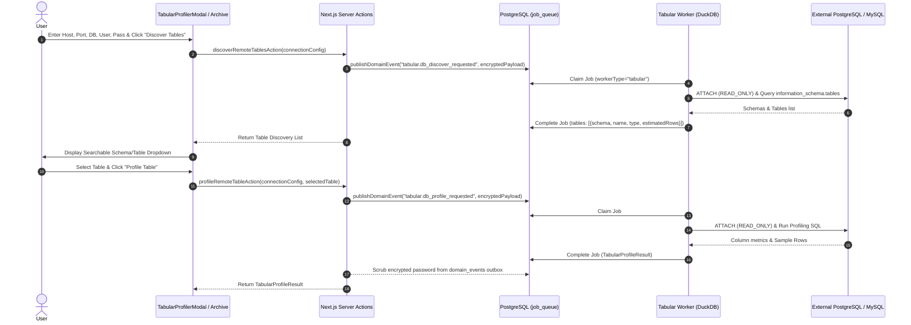
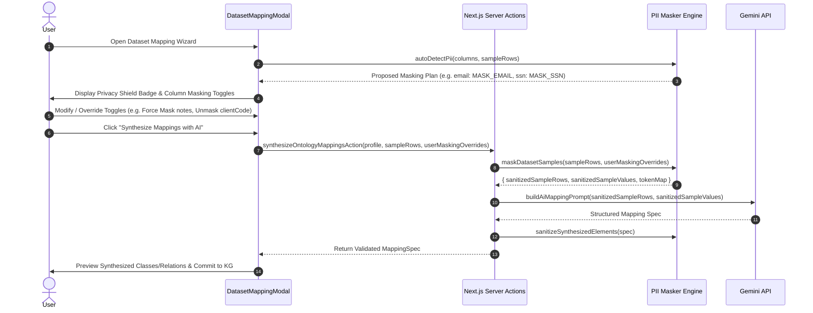

# Design Spec: Tabular Privacy Masking Pipeline with User Controls & DuckDB Read-Only SQL Connectors

**Date:** 2026-11-06  
**Status:** Approved by Builder Review & User Decisions  
**Target Phase:** Phase 3 — Multi-Source Tabular Ingestion & Privacy (`helix-foundry`), Milestones 3 & 4  
**Scope:** Client-guided local PII & sensitive data masking pipeline for LLM dispatch, paired with read-only PostgreSQL/MySQL database connectors, remote table discovery, and persistent syncable dataset sources powered by DuckDB in `services/tabular`.

---

## 1. Intent & Context

In Milestones 1 & 2 of Phase 3, `kg-workbench` introduced:
1. The **DuckDB Tabular Worker (`services/tabular`)** for local analytical profiling of CSV, Parquet, and Excel files.
2. The **Persistent Dataset Archive (`dataset_sources`)** and 5-tab left sidebar browser.
3. The **AI-assisted Dataset Mapping Wizard (`DatasetMappingModal`)**, synthesizing candidate classes, attributes, and relationships using Gemini.

Currently, two major gaps prevent enterprise-grade adoption:
1. **Unsanitized Data Leakage to External LLMs**: In `synthesizeOntologyMappingsAction`, raw sample rows and column values are sent directly to the Gemini API. Enterprise datasets often contain Personally Identifiable Information (PII) such as emails, phone numbers, IP addresses, credentials, or proprietary identifiers.
2. **File-Only Tabular Ingestion**: Real-world knowledge graphs must ingest directly from relational databases (PostgreSQL and MySQL), not only manual file exports.

This specification completes Phase 3 by introducing:
- A **Deterministic Local PII & Sensitive Column Masker** with **User Decision Rights** in the UI, ensuring no sensitive data leaves the server without explicit user consent.
- **Read-Only External SQL Database Connectors** in DuckDB (`postgres_scanner` and `mysql_scanner`), enabling interactive table discovery, remote profiling, and persistent re-syncable dataset connections.

---

## 2. Goals, Non-Goals & Anti-Goals

### Goals

1. **User-Guided Local PII Masking Engine (`src/features/tabular/server/services/pii-masker.ts`)**:
   - Deterministic pattern-matching regex for emails, phone numbers, IPv4/IPv6, credit card numbers, SSNs/Tax IDs, IBANs, JWTs, API keys, passwords, and UUIDs.
   - Heuristic column-name detection (e.g. `first_name`, `last_name`, `email`, `ssn`, `salary`, `secret`, `token`).
   - Salted placeholder token generation (e.g., `<EMAIL_1>`, `<PERSON_2>`) applied to `sampleRows` and `sampleValues`, preserving value cardinality and relational consistency during AI reasoning while column names remain clear for semantic mapping.
   - Sanitization pass over AI-generated schema elements ensuring no token artifacts leak into class/attribute descriptions.
2. **User Decision Rights in the UI (`DatasetMappingModal` & `TabularProfilerModal`)**:
   - Auto-scans columns during profiling and mapping initialization.
   - Shows a clear **Privacy Shield** header indicator and per-column privacy toggles (`Masked` / `Unmasked` / `Custom Mask`).
   - Allows users to override auto-detection: force-mask any non-detected column or unmask any false positive before triggering AI synthesis.
   - Clear visual preview of sanitized sample values before dispatch to Gemini.
3. **DuckDB Read-Only SQL Database Connectors (`services/tabular`)**:
   - Support PostgreSQL (`postgres_scanner`) and MySQL (`mysql_scanner`) connections.
   - Bundle extensions directly inside `services/tabular/Dockerfile` at image build time for offline operation.
   - Enforce strict `READ_ONLY` mode at the DuckDB `ATTACH` statement.
   - Enqueue `tabular.db_discover_tables` and `tabular.db_profile_requested` domain events through the transactional outbox and worker job queue.
   - Passwords in event payloads and database storage are encrypted at rest with AES-256-GCM (`encryptSecret`) and scrubbed from event outbox records upon job completion.
4. **Interactive Remote Database Explorer & Syncable Sources**:
   - Two-step connection UI:
     - **Step 1 (Connect & Discover)**: Enter host, port, database, user, password, and SSL mode, then click "Connect & Discover Tables".
     - **Step 2 (Select & Profile)**: Browse a searchable list of schemas and tables/views, select a target table, and click "Profile Table".
   - **Persistent & Syncable Connections**: `dataset_sources` stores connection metadata and encrypted credentials (`connection_config`), enabling a one-click "Re-sync / Re-profile" action in the Dataset Archive Browser.

### Non-Goals

- Writing back or mutating remote external SQL databases (strictly read-only).
- Storing unencrypted plaintext database passwords at rest.
- Full database-wide mass extraction in a single job (profiling is scoped table-by-table or view-by-view).

### Anti-Goals

- **No Silent Data Dispatch**: Never send unmasked tabular sample rows or column values to an external LLM API without giving the user visibility and override control.
- **No Heavy NLP Bloat in Docker**: Do not inflate the tabular worker with multi-gigabyte spaCy/PyTorch/Presidio weights; use efficient, deterministic regex and heuristic token mapping.
- **No Node.js Memory Exhaustion for Databases**: Never stream million-row database tables into Node.js heap memory. DuckDB handles remote connection scanning and analytical aggregation.
- **No Runtime CDN Dependencies**: Do not download DuckDB extensions dynamically at container runtime; bundle them at build time.

---

## 3. Approaches Considered & Selected

### 3.1 PII Masking Architecture

- **Approach A: In-Process Node.js Masker with User UI Overrides (Selected)**
  - *Details*: A deterministic TypeScript engine in `src/features/tabular/server/services/pii-masker.ts` runs prior to `buildAiMappingPrompt`. The UI provides interactive column toggles so users can review and modify the masking plan.
  - *Why Selected*: Guarantees that data from any source (CSV, Parquet, Excel, PostgreSQL, MySQL, or historical archive) is sanitized right at the Next.js API boundary before reaching Gemini. Instant execution (<2ms) and full control in the browser.
- **Approach B: Python Worker-Side Presidio/spaCy Masker**
  - *Why not*: Adds 600MB+ model weights, requires passing dual payloads through `job_queue`, and prevents immediate client-side preview and toggle without redundant roundtrips.

### 3.2 SQL Database Introspection & Profiling

- **Approach A: DuckDB Native Extensions (`postgres_scanner` & `mysql_scanner`) in Worker (Selected)**
  - *Details*: `services/tabular` attaches to the target database in read-only mode (`ATTACH '...' AS remote_db (TYPE POSTGRES, READ_ONLY)`). Remote table discovery (`information_schema.tables`) and analytical profiling queries (`COUNT(*)`, `approx_count_distinct`, null checks, candidate keys) run natively inside DuckDB.
  - *Why Selected*: 100% reuse of the analytical SQL engine, high performance, zero Node.js heap consumption, and unified output format (`TabularProfileResult`).
- **Approach B: Node.js `pg` / `mysql2` Direct Client Driver**
  - *Why not*: Requires writing and maintaining duplicate SQL profiling queries for both PostgreSQL and MySQL in TypeScript, including complex composite candidate key detection algorithms.

---

## 4. Architecture & System Workflows

### 4.1 Interactive Remote Database Discovery & Profiling Flow



### 4.2 User-Guided Privacy Masking & AI Synthesis Flow



---

## 5. Technical Specifications

### 5.1 Privacy Masking Engine (`src/features/tabular/server/services/pii-masker.ts`)

```typescript
export type PiiCategory =
  | "email"
  | "phone"
  | "ip_address"
  | "credit_card"
  | "ssn"
  | "iban"
  | "secret" // API keys, passwords, JWTs
  | "name"
  | "custom"

export interface ColumnPrivacyConfig {
  columnName: string
  isMasked: boolean
  detectedCategory?: PiiCategory
  maskingStrategy: "token" | "redact" | "none" // token: <EMAIL_1>, redact: [REDACTED]
}

export interface MaskingResult {
  sanitizedSampleRows: Record<string, unknown>[]
  sanitizedSampleValues: Record<string, Array<string | number | boolean>>
  tokenMap: Record<string, string> // token -> original value (in-memory only)
  maskedColumnCount: number
}
```

#### Deterministic Rules & Patterns
- **Email**: `/\b[A-Za-z0-9._%+-]+@[A-Za-z0-9.-]+\.[A-Z|a-z]{2,7}\b/gi`
- **Phone**: International E.164 and common national phone formats.
- **IPv4 / IPv6**: Validated subnet and IP boundaries.
- **Credit Card**: 13–19 digit patterns matching Visa, Mastercard, Amex, Discover with Luhn checksum validation.
- **SSN / Tax ID**: `/\b\d{3}-\d{2}-\d{4}\b/` and national equivalents.
- **IBAN**: Standard ISO 13616 regex with MOD-97 check.
- **Secrets / Tokens**: JWT format (`eyJh...`), AWS keys (`AKIA...`), generic Bearer tokens, and column names matching `password|secret|api_?key|token|auth`.
- **Names / Identifiers**: Column names matching `first_name|last_name|full_name|customer_name|patient_name|user_name|author`.

#### Salted Token Replacement
When a value is masked with `strategy: "token"`:
- The engine uses a session-scoped salt.
- The same value across multiple rows gets the exact same token (e.g. `john@acme.com` always maps to `<EMAIL_1>`), preserving foreign key relationships and category distributions during LLM reasoning.
- Column sample values in `TabularColumnProfile.sampleValues` are masked using the same token map.
- Real column names are preserved in the prompt so Gemini understands the semantic intent of each column.

### 5.2 User Decision Rights in UI

1. **`DatasetMappingModal` Step 1 & 2**:
   - Header Banner: **"Privacy Shield"** showing `N columns auto-masked for AI synthesis. [Review & Customize]`.
   - Column Table Row:
     - Privacy Pill: Clickable badge showing `Masked (<Type>)` (destructive/amber tint) or `Unmasked` (muted/green tint).
     - Clicking opens a popover:
       - Toggle: "Mask this column before sending to AI" (Checked/Unchecked).
       - Select: "Masking Method" (`Token Placeholder (<COL_1>)` vs `Full Redaction ([REDACTED])`).
       - Preview: Shows Before (`jane@example.com`) and After (`<EMAIL_1>`).
2. **`TabularProfilerModal`**:
   - Shows privacy classification tag in the **Schema & Types** tab for each column.

### 5.3 DuckDB External SQL Connectors (`services/tabular`)

#### Docker Build Pre-Installation
In `services/tabular/Dockerfile`:
```dockerfile
RUN python3 -c "import duckdb; conn = duckdb.connect(); conn.execute('INSTALL postgres; INSTALL mysql;')"
```

#### Worker Introspection & Profiling (`services/tabular/src/tabular/profiler.py`)
```python
def discover_remote_tables(
    db_type: Literal["postgres", "mysql"],
    host: str,
    port: int,
    database: str,
    user: str,
    password: str,
    ssl_mode: Optional[str] = "prefer"
) -> List[Dict[str, Any]]:
    # ATTACH (READ_ONLY), query information_schema.tables, DETACH, return table list

def profile_remote_database_table(
    db_type: Literal["postgres", "mysql"],
    host: str,
    port: int,
    database: str,
    user: str,
    password: str,
    table: str,
    schema: Optional[str] = "public",
    ssl_mode: Optional[str] = "prefer"
) -> TabularProfileResult:
    # ATTACH (READ_ONLY), run analytical profiling SQL, extract metrics + sample rows, DETACH
```

### 5.4 Database Schema Updates (`dataset_sources`)

In `src/server/db/schema.ts`, extend `dataset_sources` to store connection parameters for persistent sync:
```typescript
export const datasetSources = pgTable(
  "dataset_sources",
  {
    id: uuid("id").defaultRandom().primaryKey(),
    ontology_id: uuid("ontology_id")
      .notNull()
      .references(() => ontologyDocuments.id, { onDelete: "cascade" }),
    group_key: text("group_key").notNull().default("shared"),
    source_name: text("source_name").notNull(),
    file_format: text("file_format").notNull(), // "csv" | "parquet" | "excel" | "postgres" | "mysql"
    row_count: integer("row_count").notNull(),
    column_count: integer("column_count").notNull(),
    profile_summary: jsonb("profile_summary").notNull(),
    sample_rows: jsonb("sample_rows").notNull(),
    mapping_spec: jsonb("mapping_spec"),
    connection_config: jsonb("connection_config"), // Encrypted host, port, db, user, table, encrypted_pass
    last_synced_at: timestamp("last_synced_at", { withTimezone: true }),
    created_at: timestamp("created_at", { withTimezone: true }).defaultNow().notNull(),
    updated_at: timestamp("updated_at", { withTimezone: true }).defaultNow().notNull(),
  }
)
```

### 5.5 Database Connection UI & Re-Sync Actions
- **`TabularProfilerModal`**:
  - Source Tabs: `Upload File` (CSV/Parquet/Excel) | `Remote Database` (Postgres/MySQL).
  - Two-Step Workflow:
    - Step 1: Host, Port, Database, Username, Password, SSL Mode + "Discover Tables" button.
    - Step 2: Searchable Combobox for Schema/Table + "Profile Table" button.
- **`DatasetArchiveBrowser`**:
  - Displays database icon badge for SQL sources.
  - Includes a **"Re-sync"** button on database cards to fetch updated table metrics and sample rows.

---

## 6. Security & Privacy Safeguards

1. **Zero Raw Leakage**: No sample row with sensitive values is transmitted to Gemini.
2. **Strict Read-Only SQL**: DuckDB `ATTACH` is explicitly configured with `READ_ONLY`. No `INSERT`, `UPDATE`, `DROP`, or `ALTER` statements can execute.
3. **Encrypted Passwords at Rest**: Database passwords in `connection_config` and job payloads are encrypted with authenticated AES-256-GCM (`encryptSecret`).
4. **Outbox Password Scrubbing**: Passwords are permanently deleted from `domain_events.payload` upon job completion.
5. **User Override Authority**: If an automated regex falsely flags a code as sensitive, or if an unflagged proprietary column needs protection, the user can toggle it with a single click in the UI.

---

## 7. Verification Plan

1. **PII Masker Unit Tests (`tests/tabular-pii-masker.test.ts`)**:
   - Test email, phone, IP, credit card, SSN, IBAN, and secret masking.
   - Verify token consistency (same original value -> same placeholder token across rows).
   - Verify user override options (force-masking a normal column and unmasking a detected column).
   - Verify prompt sanitization (`buildAiMappingPrompt` contains zero raw PII).
2. **DuckDB Database Scanner Integration Test (`services/tabular/tests/test_db_connectors.py`)**:
   - Unit test DuckDB `postgres_scanner` against the local compose PostgreSQL container (`db:5432`).
   - Test table discovery (`discover_remote_tables`) and table profiling (`profile_remote_database_table`).
3. **End-to-End Workflow Verification**:
   - Discover and profile a database table, review privacy shield masking choices, synthesize ontology mappings with Gemini, and verify clean commit into active ontology.
   - Verify re-sync action against the archived database source.
   - Run `pnpm check` (lint, typecheck, tests, build) to ensure zero regressions.
